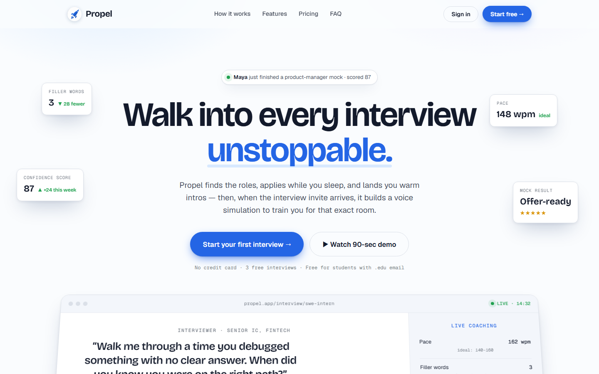
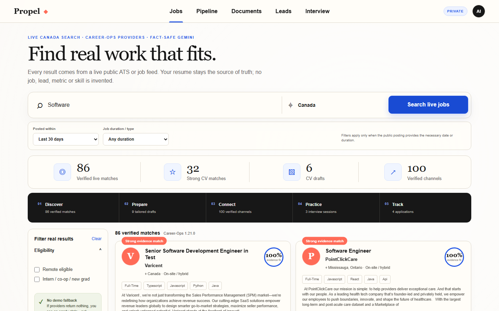
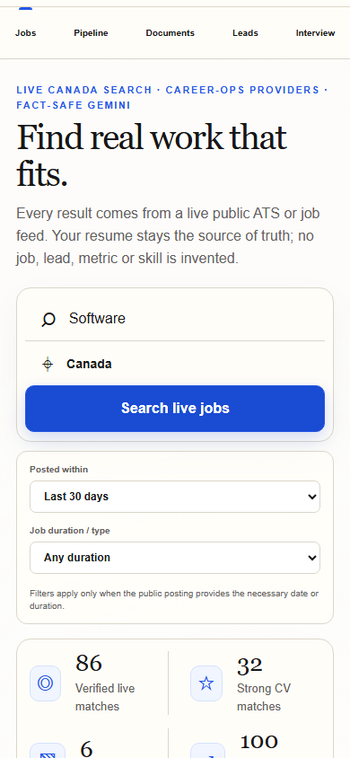
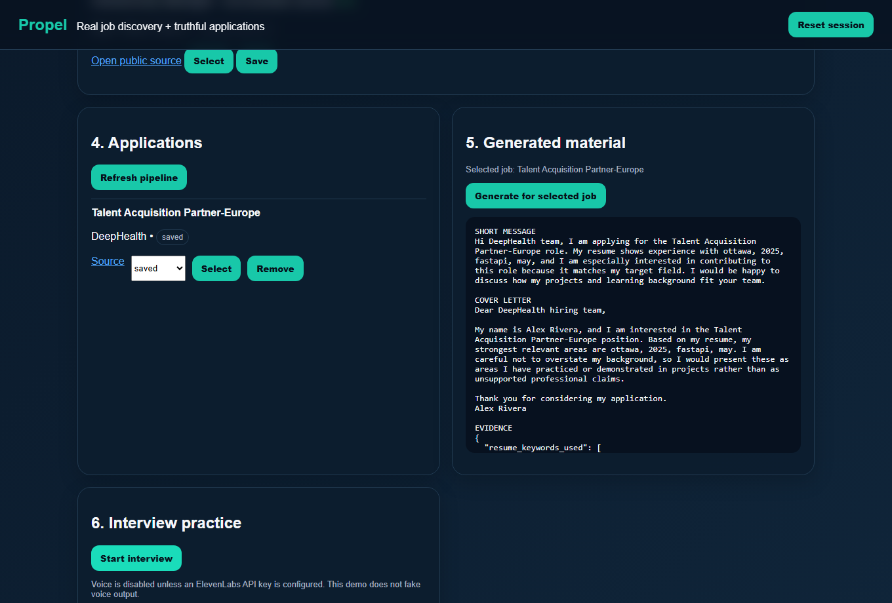
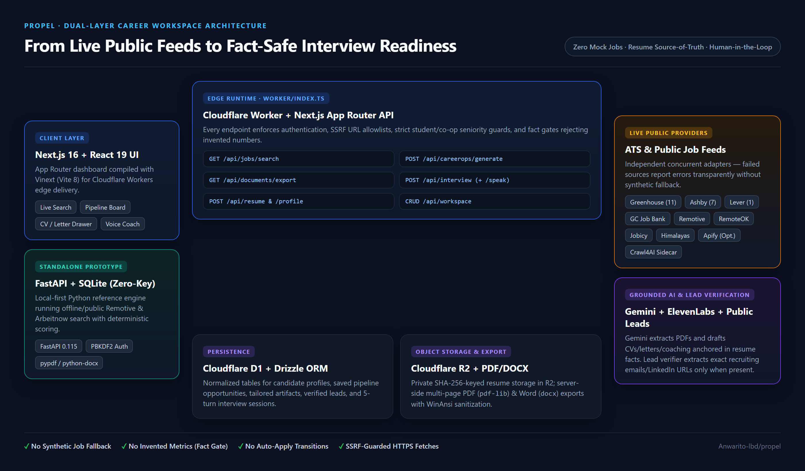
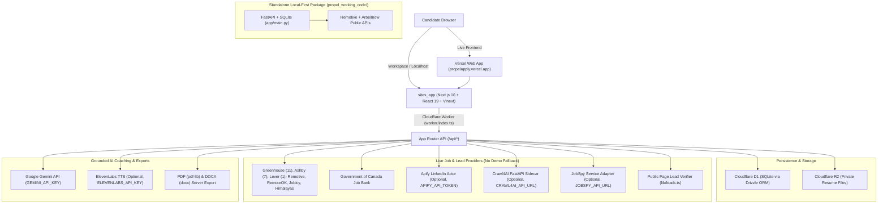

# Propel — From Live Job Lead to Interview-Ready

> **Live Frontend:** [https://propelapply.vercel.app/](https://propelapply.vercel.app/)  
> [](https://propelapply.vercel.app/)

I built **Propel** as an honest, fact-safe career workspace for Canadian students and early-career engineers. Every job listing comes from a live public provider or ATS feed—never synthetic demo cards—and every tailored CV, cover letter, outreach draft, and interview question is grounded strictly in the candidate's uploaded resume.

This repository contains the live web frontend (**[propelapply.vercel.app](https://propelapply.vercel.app/)**) alongside two verified backend/workspace implementations:
- **`sites_app/`** — The full-stack production web application built with **Next.js 16**, **React 19**, **Vinext (Vite 8)**, **Drizzle ORM**, and **Cloudflare Workers** (D1 SQLite + R2 object storage), with Gemini document/interview coaching, server-side PDF/DOCX exports, public lead verification, optional ElevenLabs narration, and an optional Crawl4AI Python sidecar.
- **`propel_working_code/`** — A standalone, zero-key local-first **FastAPI + SQLite** reference package that runs live Remotive and Arbeitnow searches, deterministic keyword scoring, resume parsing (TXT/PDF/DOCX), application pipeline management, and evidence-backed drafts without requiring any external API keys.

---

## Live Deployment & Visual Proof

### Live Production Frontend ([propelapply.vercel.app](https://propelapply.vercel.app/))


### Interactive Workspace Walkthrough (`sites_app`)


- Live Production Frontend: **[https://propelapply.vercel.app/](https://propelapply.vercel.app/)**
- Full screen-recorded walkthrough video: [docs/images/propel-walkthrough.mp4](docs/images/propel-walkthrough.mp4)

### Desktop, Mobile & FastAPI Prototype Screenshots

| Full-Stack Edge UI (`sites_app`, `1440×900`) | Mobile Responsive UI (`sites_app`, `390×844`) |
| :---: | :---: |
|  |  |

**Local-First Zero-Key FastAPI Prototype (`propel_working_code` on `http://127.0.0.1:8010`):**


---

## Architecture & Workflow





---

## Tools, Skills, AI Models & Engineering Stack

| Layer | Technologies, Models & Packages (from Repo Manifests) |
| :--- | :--- |
| **AI Models & Voice** | **Google Gemini API** (`gemini-3-flash-preview` with `gemini-2.5-flash` fallback, override via `GEMINI_MODEL`) for multimodal PDF resume extraction, grounded CV/cover-letter/outreach drafting, and 5-turn mock interview coaching; **ElevenLabs TTS** (`eleven_multilingual_v2`, optional via `ELEVENLABS_API_KEY`) + Web Speech API (`SpeechRecognition` / `speechSynthesis`) |
| **Edge Web App (`sites_app`)** | **Next.js** `16.2.6` (App Router), **React** `19.2.6`, **Vinext** `0.0.50`, **Vite** `8.0.13`, **TypeScript** `5.9.3`, **Tailwind CSS** `4.2.1` |
| **Cloudflare & Persistence** | **Cloudflare Workers** (`@cloudflare/vite-plugin` `1.37.1`, `wrangler` `4.92.0`), **Cloudflare D1** via **Drizzle ORM** `0.45.2` + `drizzle-kit` `0.31.10`, **Cloudflare R2** object storage |
| **Document Export** | `pdf-lib` (`^1.17.1`) for multi-page WinAnsi-sanitized PDF generation and `docx` (`^9.5.1`) for editable Word exports (`sites_app/lib/documents.ts`) |
| **Live Job Discovery & Sidecars** | **Career-Ops** HTTP provider patterns (`santifer/career-ops` v1.21.0, MIT), **JobSpy** filter vocabulary (`speedyapply/JobSpy` reference), **Government of Canada Job Bank** HTML parser, **Crawl4AI** Python sidecar (`crawl4ai>=0.9.0`, `fastapi>=0.115.0`, `uvicorn>=0.34.0`, `pydantic>=2.10.0`), optional **Apify** LinkedIn Actor |
| **Standalone Prototype (`propel_working_code`)** | **FastAPI** `0.115.6`, **Uvicorn** `0.34.0`, **SQLite** (PBKDF2-SHA256 auth + manual pipeline state), **httpx** `0.28.1`, **pypdf** `5.1.0`, **python-docx** `1.1.2`, **Pydantic** `2.10.5` |
| **Verification & Tooling** | **Node Test Runner** (`node --test`), **ESLint** `9.39.4` (`eslint-config-next` `16.2.6`), **pytest** `8.3.4`, **Playwright** (UI capture & walkthrough video), **FFmpeg** (MP4/GIF encoding) |
| **Core Engineering Skills** | Fact-gated LLM orchestration, SSRF-guarded outbound HTTPS fetching, strict student/co-op title filtering, multi-environment Cloudflare Worker bundling, server-side binary PDF/DOCX rendering, and automated full-stack testing |

---

## Proof of Work & Verification Summary

All checks are executed after edits and recorded in detail in [docs/PROOF_OF_WORK.md](docs/PROOF_OF_WORK.md):

- **`sites_app`:** `npm run lint` (ESLint), `npx tsc --noEmit`, and `npm run test:local` (`vinext build` + `node --test tests/*.test.mjs` — **10/10 tests passed**).
- **`propel_working_code`:** `pytest -v` (**7/7 tests passed**) + live FastAPI smoke flow (`uvicorn app.main:app` returning HTTP 200 across signup, resume upload, live search, save, status update, generate, and interview endpoints).

---

## Setup & Running Locally

### Option 1: Full-Stack Edge App (`sites_app/`)

1. **Install dependencies:**
   ```powershell
   cd sites_app
   npm ci
   ```
2. **Configure environment variables:**
   Copy `sites_app/.env.example` to `sites_app/.env.local`:
   - `GEMINI_API_KEY` — required for AI PDF resume extraction, tailored CV/cover-letter/outreach generation, and Interview Coach feedback (`GEMINI_MODEL` optional override).
   - `ELEVENLABS_API_KEY` / `ELEVENLABS_VOICE_ID` — optional; enables server-side voice narration in Interview Coach.
   - `APIFY_API_TOKEN` — optional; adds up to 10 recent LinkedIn results per search. Without it, all public ATS/Job Bank/remote feeds still run.
   - `CRAWL4AI_API_URL` / `CRAWL4AI_API_KEY` and `JOBSPY_API_URL` / `JOBSPY_API_KEY` — optional external crawler/scraper adapters.
3. **Run locally (simulated local D1 + R2 bindings via Vite + Cloudflare plugin):**
   ```powershell
   npm run dev
   ```
   Open [http://localhost:5173](http://localhost:5173).
4. **Lint, typecheck, build, and run tests:**
   ```powershell
   npm run lint
   npx tsc --noEmit
   npm run test:local
   ```

### Option 2: Zero-Key FastAPI Prototype (`propel_working_code/`)

Runs completely locally with no API keys required:

```powershell
cd propel_working_code
python -m venv .venv
.\.venv\Scripts\Activate.ps1   # macOS/Linux: source .venv/bin/activate
pip install -r requirements.txt
python -m uvicorn app.main:app --reload --port 8000
```

Open [http://127.0.0.1:8000](http://127.0.0.1:8000) and run tests with `pytest -v`.

---

## Further Reading

- [docs/CASE_STUDY.md](docs/CASE_STUDY.md) — Engineering case study covering the problem, architecture decisions, safety boundaries, and bug fixes.
- [docs/PROOF_OF_WORK.md](docs/PROOF_OF_WORK.md) — Exact observed test runs, build logs, live smoke tests, and visual verification artifacts.
- [sites_app/CAREEROPS_INTEGRATION.md](sites_app/CAREEROPS_INTEGRATION.md) — Provenance and integration notes for Career-Ops and JobSpy patterns.
