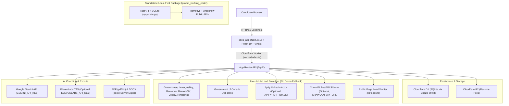

# Propel — From Live Job Lead to Interview-Ready

I built **Propel** as an honest, fact-safe career workspace for Canadian students and early-career engineers. Every job listing comes from a live public provider or ATS feed—never synthetic demo cards—and every tailored CV, cover letter, outreach draft, and interview question is grounded strictly in the candidate's uploaded resume.

This repository contains two verified implementations of the Propel workflow:
- **`sites_app/`** — The full-stack production web application built with **Next.js 16**, **React 19**, **Vinext (Vite 8)**, **Drizzle ORM**, and **Cloudflare Workers** (D1 SQLite + R2 object storage), with Gemini document/interview coaching, PDF/DOCX exports, public lead verification, and an optional Crawl4AI Python sidecar.
- **`propel_working_code/`** — A standalone, zero-key local-first **FastAPI + SQLite** reference package that runs live Remotive and Arbeitnow searches, deterministic keyword scoring, resume parsing (TXT/PDF/DOCX), and template-based drafts without requiring any external API keys.

---

## Proof of Work & Local Verification

All checks below were executed locally and recorded in [docs/demo-output.txt](docs/demo-output.txt):

| Package | Command | Verified Result |
| :--- | :--- | :--- |
| `sites_app` | `npm run test:local` (`vinext build` + `node --test tests/*.test.mjs`) | **Build succeeded** (313 client / 50 server / 365 RSC modules); **8/8 tests passed** |
| `sites_app` | `eslint .` | **0 errors, 0 warnings** |
| `propel_working_code` | `pytest -v` | **7/7 tests passed** |
| `propel_working_code` | Live FastAPI API smoke flow (`uvicorn app.main:app`) | **HTTP 200**; live Remotive search, resume upload, save, generate, and interview endpoints verified |

### Screenshots

**Full-Stack Workspace (`sites_app` on `http://localhost:5173`):**


**Local-First FastAPI Prototype (`propel_working_code` on `http://127.0.0.1:8010`):**


---

## Architecture



---

## Verified Tech Stack (from Manifests)

### `sites_app/package.json`
- **Framework & Runtime:** `next` (`16.2.6`), `react` (`19.2.6`), `react-dom` (`19.2.6`), `vinext` (`0.0.50`), `vite` (`8.0.13`), `@cloudflare/vite-plugin` (`1.37.1`), `wrangler` (`4.92.0`), Node `>=22.13.0`
- **Database & ORM:** `drizzle-orm` (`0.45.2`), `drizzle-kit` (`0.31.10`) targeting Cloudflare D1 (SQLite)
- **Document Generation:** `pdf-lib` (`^1.17.1`), `docx` (`^9.5.1`)
- **Styling & Tooling:** `tailwindcss` (`4.2.1`), `@tailwindcss/postcss` (`4.2.1`), `typescript` (`5.9.3`), `eslint` (`9.39.4`), `eslint-config-next` (`16.2.6`)

### `propel_working_code/requirements.txt` & `sites_app/services/crawl4ai/requirements.txt`
- **Core Python Prototype:** `fastapi==0.115.6`, `uvicorn[standard]==0.34.0`, `httpx==0.28.1`, `python-multipart==0.0.20`, `pydantic==2.10.5`, `python-docx==1.1.2`, `pypdf==5.1.0`, `pytest==8.3.4`
- **Crawl4AI Sidecar:** `crawl4ai>=0.9.0`, `fastapi>=0.115.0`, `uvicorn[standard]>=0.34.0`, `pydantic>=2.10.0`

---

## Setup & Running Locally

### Option 1: Full-Stack App (`sites_app/`)

1. **Install dependencies:**
   ```powershell
   cd sites_app
   npm ci
   ```
2. **Configure environment variables:**
   Copy `.env.example` to `.env.local`:
   - `GEMINI_API_KEY` — required for AI resume extraction (PDF), tailored CV/cover-letter/outreach generation, and Interview Coach feedback.
   - `ELEVENLABS_API_KEY` — optional; enables server-side voice narration in Interview Coach.
   - `APIFY_API_TOKEN` — optional; adds up to 10 recent LinkedIn results per search. Without it, all public ATS/Job Bank/remote feeds still run.
   - `CRAWL4AI_API_URL` / `JOBSPY_API_URL` — optional sidecar URLs.
3. **Run locally (uses simulated local D1 + R2 bindings via Vite + Cloudflare plugin):**
   ```powershell
   npm run dev
   ```
   Open [http://localhost:5173](http://localhost:5173).
4. **Build and run tests:**
   ```powershell
   npm run test:local
   ```

### Option 2: Zero-Key FastAPI Prototype (`propel_working_code/`)

Runs completely locally with no API keys required:

```powershell
cd propel_working_code
python -m venv .venv
.\.venv\Scripts\Activate.ps1   # macOS/Linux: source .venv/bin/activate
pip install -r requirements.txt
python -m uvicorn app.main:app --reload --port 8000
```

Open [http://127.0.0.1:8000](http://127.0.0.1:8000) and run tests with `pytest -v`.

---

## Further Reading

- [docs/CASE_STUDY.md](docs/CASE_STUDY.md) — Engineering case study covering the problem, architecture decisions, safety boundaries, and verification results.
- [docs/demo-output.txt](docs/demo-output.txt) — Raw captured test and live API verification logs.
- [sites_app/CAREEROPS_INTEGRATION.md](sites_app/CAREEROPS_INTEGRATION.md) — Provenance and integration notes for Career-Ops and JobSpy patterns.
