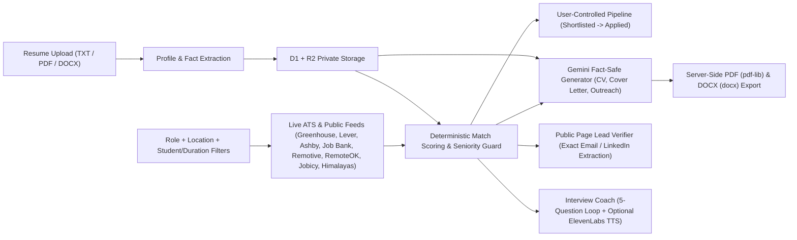

# Case Study: Building Propel — A Fact-Safe, Zero-Fake-Data Career Workspace

**Author:** Anwar Issaoui  
**Role:** Full-Stack & AI Systems Engineer (SEG2105 Software Engineering Project)

---

## 1. The Problem I Wanted to Solve

Most AI job-search tools fail candidates in two ways:
1. **Synthetic or stale job data:** When a scraper or API fails, many demos silently fall back to hardcoded mock listings, leaving students applying to roles that do not exist.
2. **Resume hallucination & auto-apply risk:** Generic LLM wrappers invent metrics, exaggerate seniority, or fire off unreviewed applications.

I built **Propel** around a strict engineering rule: **no fake jobs, no invented resume facts, and no autonomous submissions.** Every job card must come from a live public provider with source health reporting, and every tailored CV, cover letter, outreach draft, and interview question must trace back to the candidate's uploaded resume.

---

## 2. How I Designed the System

I structured Propel in two complementary layers:

1. **A Zero-Key Local-First Prototype (`propel_working_code/`)**  
   Built with **FastAPI**, **SQLite**, `httpx`, `pypdf`, and `python-docx` to validate the core workflow offline/locally without paid APIs. It authenticates users with PBKDF2-SHA256 password hashing, parses TXT/PDF/DOCX resumes, queries Remotive and Arbeitnow live, penalizes senior titles for student/co-op searches, and generates deterministic evidence-backed drafts.

2. **A Production-Ready Edge Web App (`sites_app/`)**  
   Built with **Next.js 16 (App Router)**, **React 19**, **Vinext (Vite 8)**, and **Cloudflare Workers** (`@cloudflare/vite-plugin` + `wrangler`), backed by **Cloudflare D1** (via **Drizzle ORM**) and **Cloudflare R2** for private resume storage.

---

## 3. Key Engineering Decisions & Safety Boundaries

- **Isolated Provider Failures (No Demo Fallback):** In `sites_app/lib/careerops-live.ts`, each provider (19 Canadian/Canada-eligible Greenhouse, Lever, and Ashby company boards, Government of Canada Job Bank, Remotive, RemoteOK, Jobicy, Himalayas, and optional Apify/Crawl4AI/JobSpy) is queried independently. If one fails, its error is surfaced in `sources` metadata while the remaining providers still return results.
- **Strict Student & Co-op Filtering:** In `sites_app/lib/job-filters.mjs`, student searches require explicit intern/co-op/student/new-grad evidence and reject senior leadership titles (e.g., filtering out "Senior Software Engineer — Mentor interns").
- **Public-Page Lead Verification:** In `sites_app/lib/leads.ts`, Propel fetches only validated public HTTPS job pages (`allowedPublicHttpsUrl`) and surfaces a recruiting email or LinkedIn profile **only** when it appears verbatim in recruiting context on the page; otherwise it falls back to the official application channel URL.
- **Human-in-the-Loop Pipeline & Drafts:** The `/api/workspace` endpoint rejects invalid automated state transitions (e.g., `"Auto-applied"` returns HTTP `400`), keeping the candidate in control.
- **Server-Side PDF & DOCX Generation:** Rather than relying on browser print dialogs, `/api/documents/export` renders clean multi-page PDFs with `pdf-lib` and editable Word documents with `docx`.

---

## 4. Verification & Proof of Work

During portfolio packaging on Windows (Node `v24.19.0`, Python `3.12.10`), I audited and verified both packages:

- **Fixed a Windows multi-environment Vite build race:** Running `vinext build` initially failed in `sites_app/build/sites-vite-plugin.ts` because Vite 8 invokes `closeBundle()` concurrently across environments (`client`, `ssr`, `rsc`), causing a `rm`/`cp` race on `dist/.openai/drizzle/meta`. I serialized `closeBundle()` with a promise queue so `vinext build` completes cleanly on Windows and Unix.
- **All automated checks pass:**
  - `sites_app`: `npm run test:local` built all 10 App Router routes cleanly and passed **8/8** Node tests (`tests/full-flow.test.mjs`, `tests/rendered-html.test.mjs`). `eslint` passed with **0 errors**.
  - `propel_working_code`: `pytest -v` passed **7/7** tests (`tests/test_core.py`, `tests/test_api_smoke.py`).
- **Live local demos verified:** Both the FastAPI server (`http://127.0.0.1:8010`) and the Vite/Vinext dev server (`http://localhost:5173`) served HTTP 200 locally, with screenshots captured in [docs/images/propel-sites-app.png](images/propel-sites-app.png) and [docs/images/propel-fastapi-demo.png](images/propel-fastapi-demo.png), and raw logs in [docs/demo-output.txt](demo-output.txt).

---

## 5. What Requires External Keys

- **Runs without any keys:** `propel_working_code/` (full UI, live Remotive/Arbeitnow search, resume parsing, deterministic scoring & drafts, interview questions) and `sites_app/` local UI, D1/R2 simulation, live ATS/Job Bank/remote feeds, public lead verification, and PDF/DOCX export.
- **Requires API keys in `sites_app/.env.local`:** `GEMINI_API_KEY` (AI resume PDF extraction, tailored CV/cover letter/outreach, and interview coaching), `ELEVENLABS_API_KEY` (optional voice narration), and `APIFY_API_TOKEN` (optional LinkedIn search actor).
