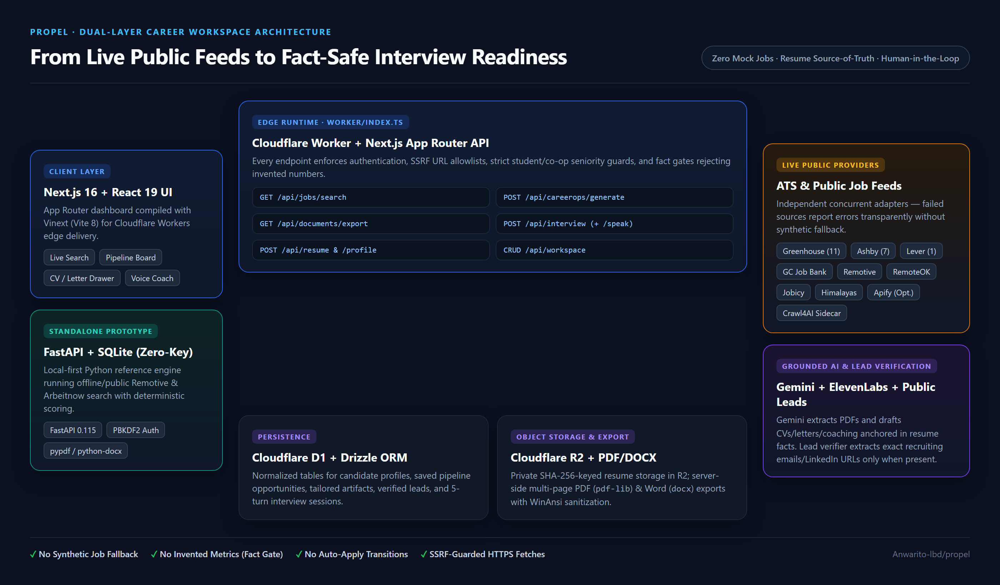
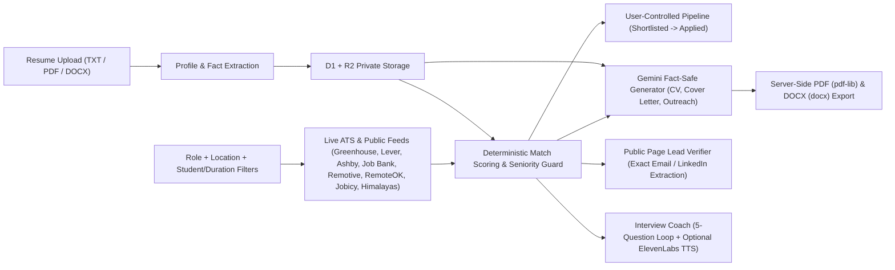

# Case Study: Building Propel — A Fact-Safe, Zero-Fake-Data Career Workspace

**Author:** Anwar Issaoui  
**Role:** Full-Stack & AI Systems Engineer (SEG2105 Software Engineering Project — Evolution of [uLink v1](https://github.com/Anwarito-lbd/Ulink))  
**Live Frontend:** [https://propelapply.vercel.app/](https://propelapply.vercel.app/)

---

## 1. The Problem I Wanted to Solve

Most AI job-search tools fail candidates in two ways:
1. **Synthetic or stale job data:** When a scraper or API fails, many demos silently fall back to hardcoded mock listings, leaving students applying to roles that do not exist.
2. **Resume hallucination & auto-apply risk:** Generic LLM wrappers invent metrics, exaggerate seniority, or fire off unreviewed applications.

After validating initial profile-based opportunity ranking in **uLink v1** (static JSON + browser `localStorage`), I built **Propel** around a strict engineering rule: **no fake jobs, no invented resume facts, and no autonomous submissions.** Every job card must come from a live public provider with source health reporting, and every tailored CV, cover letter, outreach draft, and interview question must trace back to the candidate's uploaded resume.

---

## 2. System Architecture

I structured Propel in two complementary layers:

1. **A Zero-Key Local-First Prototype (`propel_working_code/`)**  
   Built with **FastAPI**, **SQLite**, `httpx`, `pypdf`, and `python-docx` to validate the core workflow locally without paid APIs. It authenticates users with PBKDF2-SHA256 password hashing, parses TXT/PDF/DOCX resumes, queries Remotive and Arbeitnow live, penalizes senior titles for student/co-op searches, enforces manual pipeline stage updates, and generates deterministic evidence-backed drafts.

2. **A Production-Ready Edge Web App & Live Frontend (`sites_app/` + [propelapply.vercel.app](https://propelapply.vercel.app/))**  
   Deployed frontend at **[https://propelapply.vercel.app/](https://propelapply.vercel.app/)**, backed by **Next.js 16 (App Router)**, **React 19**, **Vinext (Vite 8)**, and **Cloudflare Workers** (`@cloudflare/vite-plugin` + `wrangler`), with **Cloudflare D1** (via **Drizzle ORM**) and **Cloudflare R2** for private resume storage.

---

## 3. Key Engineering Decisions & Safety Boundaries

- **Isolated Provider Failures (No Demo Fallback):** In `sites_app/lib/careerops-live.ts`, each provider (19 Canadian/Canada-eligible Greenhouse, Lever, and Ashby company boards, Government of Canada Job Bank, Remotive, RemoteOK, Jobicy, Himalayas, and optional Apify/Crawl4AI/JobSpy) is queried independently via `Promise.allSettled`. If one fails, its error is surfaced in `sources` metadata while the remaining providers still return results.
- **Strict Student & Co-op Filtering:** In `sites_app/lib/job-filters.mjs`, student searches require explicit intern/co-op/student/new-grad evidence and reject senior leadership titles (e.g., filtering out `"Senior Software Engineer — Mentor interns"`).
- **Fact Gate on AI Generation:** In `sites_app/app/api/careerops/generate/route.ts`, `rejectInventedNumbers()` blocks any Gemini draft containing numeric claims absent from the candidate's uploaded resume and verified job posting.
- **Public-Page Lead Verification & SSRF Guard:** In `sites_app/lib/public-url.ts` and `sites_app/lib/leads.ts`, Propel fetches only validated public HTTPS job pages (`allowedPublicHttpsUrl`, rejecting `http://`, `localhost`, loopback/private IPs, embedded credentials, and non-443 ports) and surfaces a recruiting email or LinkedIn profile **only** when it appears verbatim in recruiting context on the page; otherwise it falls back to the official application channel URL.
- **Human-in-the-Loop Pipeline & Drafts:** Both `sites_app` (`PATCH /api/workspace`) and `propel_working_code` (`POST /api/applications/status`) reject automated transitions such as `"Auto-applied"` with HTTP `400`, keeping the candidate in control.
- **Server-Side PDF & DOCX Generation:** Extracted into `sites_app/lib/documents.ts`, `/api/documents/export` renders multi-page PDFs with `pdf-lib` (sanitizing curly quotes, em-dashes, and non-WinAnsi Unicode symbols) and editable Word documents with `docx`.

---

## 4. Hardening Fixes & Engineering Improvements

During full-stack auditing on Windows (`Node v24.19.0`, `Python 3.12.10`), I identified and resolved several real reliability and cross-platform issues:

1. **Vite 8 Multi-Environment `closeBundle()` Race:** Serialized `closeBundle()` in `sites_app/build/sites-vite-plugin.ts` with a promise queue so concurrent `client`, `ssr`, and `rsc` environment builds never race on `dist/.openai/drizzle/meta`.
2. **Cross-Platform Linting & Shell Scripts:** Converted `sites_app/scripts/*.sh` to LF line endings with `.gitattributes` enforcement (`*.sh text eol=lf`) and made `npm run lint` invoke `eslint` directly across Windows and Unix without WSL bash path mismatches.
3. **PDF WinAnsi Encoding Crash Prevention:** Extracted `sites_app/lib/documents.ts` and added curly-quote/non-WinAnsi sanitization in `plain()` so `pdf-lib` standard fonts never throw encoding errors when resumes or AI outputs contain Unicode punctuation (`“ ”`, `✓`, `→`, `•`).
4. **FastAPI Prototype Completeness & Test Isolation:**
   - Updated `propel_working_code/app/database.py` to resolve `PROPEL_DB` dynamically at query time (`get_db_path()`) so isolated `pytest` fixtures never touch a workspace database.
   - Migrated `propel_working_code/app/main.py` from deprecated `@app.on_event('startup')` to FastAPI `lifespan`, added status allowlist validation (`400` on `"Auto-applied"`), `DELETE /api/applications/{application_id}`, and `applications` table fallback for `/api/interview`.
   - Replaced blocking `alert()` calls in `propel_working_code/app/static/script.js` with inline status updates, HTML/URL escaping, and interactive pipeline status/select/delete controls.

---

## 5. What Requires External Keys

- **Runs without any keys:** `propel_working_code/` (full UI, live Remotive/Arbeitnow search, resume parsing, deterministic scoring & drafts, pipeline CRUD, interview questions) and `sites_app/` local UI, D1/R2 simulation, live ATS/Job Bank/remote feeds, public lead verification, and PDF/DOCX export.
- **Optional / AI keys in `sites_app/.env.local`:** `GEMINI_API_KEY` (AI PDF resume extraction, tailored CV/cover letter/outreach, and interview coaching), `ELEVENLABS_API_KEY` (server-side voice narration), `APIFY_API_TOKEN` (LinkedIn public jobs actor), and `CRAWL4AI_API_URL` / `JOBSPY_API_URL` (external Python sidecars).
